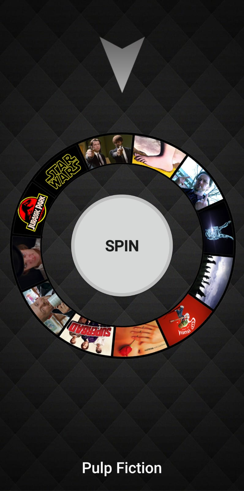

# MoviePicker

MoviePicker é um pequeno app Android para quem não consegue decidir o que assistir. Ele mostra uma roleta de filmes: gire, e o filme em que ela parar é a escolha da noite.

<p align="center">
  
</p>

## Como funciona

- **Botão Spin**: toque em **Spin**, no centro da tela, para girar a roleta com uma velocidade aleatória.
- **Girar com o dedo**: você também pode arrastar a roleta para girá-la ou dar um "peteleco" para girá-la você mesmo. O giro segue a direção do seu dedo.
- **Resultado**: a roleta desacelera até parar, e o filme indicado pela seta aparece na parte de baixo da tela. Enquanto ela gira, o texto mostra "Rotating..".

A roleta tem 12 fatias de 30° cada:

| Filmes | | |
| --- | --- | --- |
| Lord of the Rings | Donnie Darko | Filth |
| Monty Python | Pulp Fiction | Star Wars |
| Jurassic Park | A Clockwork Orange | Shaun of the Dead |
| Superbad | American Beauty | Scott Pilgrim vs. the World |

## Estrutura do projeto

| Caminho | Descrição |
| --- | --- |
| `app/src/main/java/.../MainActivity.java` | Toda a lógica do app: toques, detecção do gesto de arremesso, animação do giro e conversão do ângulo final em um filme |
| `app/src/main/res/layout/activity_main.xml` | Layout: fundo, imagem da roleta, botão redondo Spin e texto do resultado |
| `app/src/main/res/drawable/` | Imagens da roleta, dos fundos e o formato do botão |

Como o giro funciona: a imagem da roleta é rotacionada com uma `Matrix`. Um `GestureDetector` converte os gestos em velocidade de rotação, e um `Runnable` se reagenda a cada quadro, girando a roleta e reduzindo a velocidade até ela ficar abaixo de um limite. O ângulo final é então normalizado para 0–360° e associado a um filme.

O código da roleta é baseado no tutorial de [Ralf Wondratschek](http://www.vrallev.net).

## Requisitos

- Android Studio (versão recente)
- JDK 17 (o JDK que vem com o Android Studio funciona)
- Android SDK Platform 35
- Um dispositivo ou emulador com Android 5.0 (API 21) ou superior

## Como compilar e executar

1. Clone o repositório:
   ```sh
   git clone https://github.com/LorenzoFeldens/MoviePicker.git
   ```
2. Abra a pasta no Android Studio e aguarde a sincronização do Gradle. Ela cria o `local.properties` com o caminho do seu SDK.
3. Execute a configuração `app` em um dispositivo ou emulador.

Para compilar pela linha de comando:

```sh
./gradlew assembleDebug
```

O APK é gerado em `app/build/outputs/apk/debug/app-debug.apk`.

## Tecnologias

- Java
- Gradle 9.3, Android Gradle Plugin 8.13.2
- AndroidX AppCompat
- compileSdk / targetSdk 35, minSdk 21
